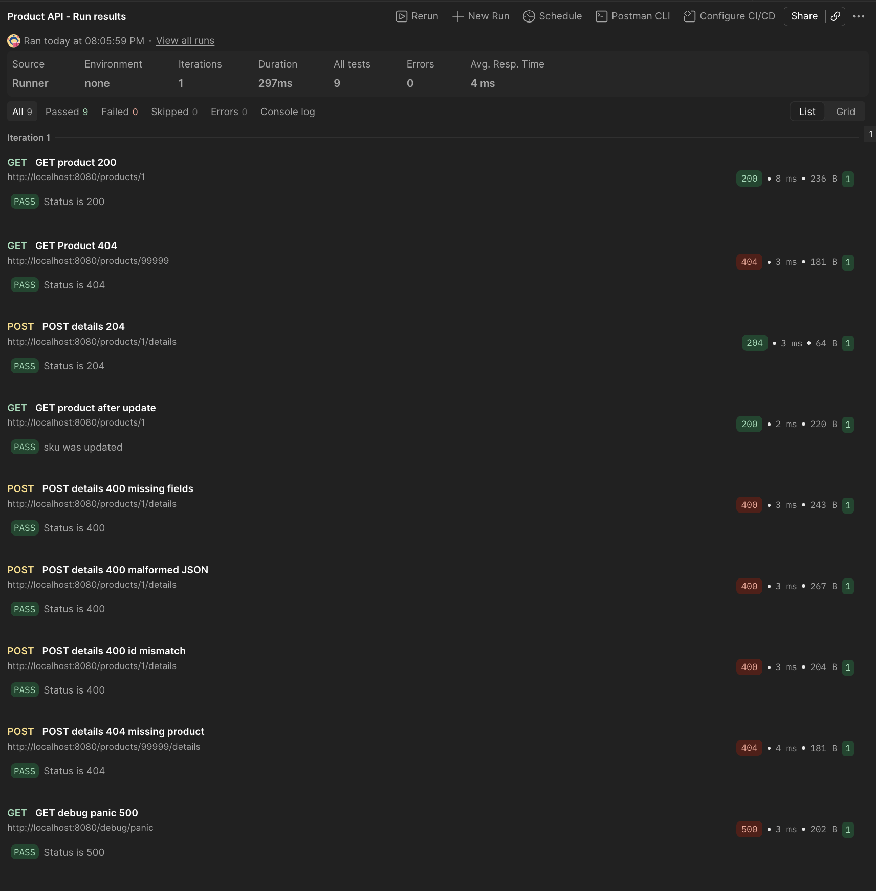
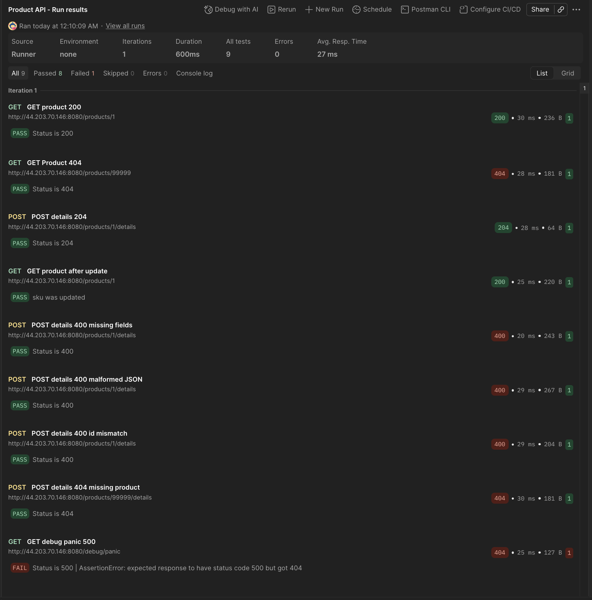
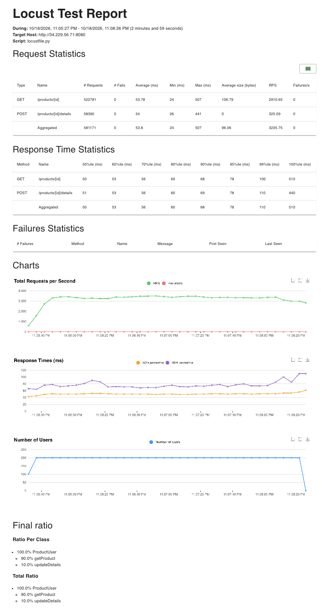
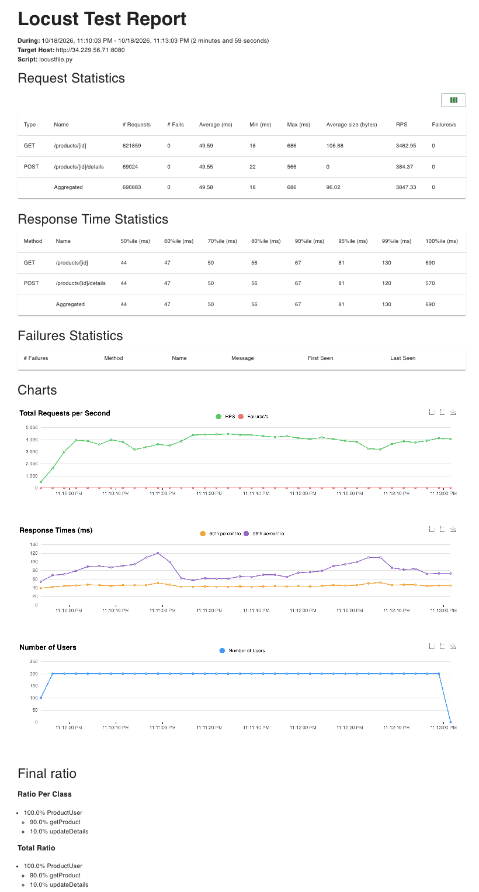
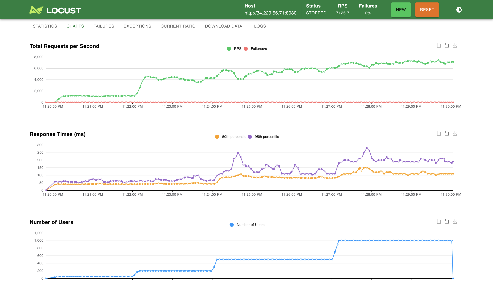
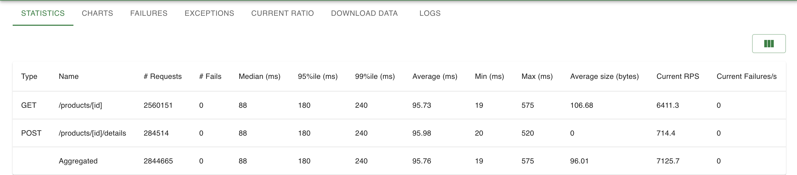
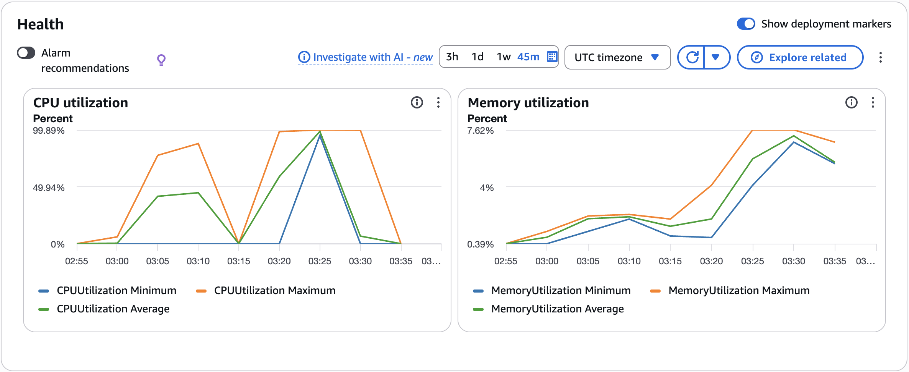
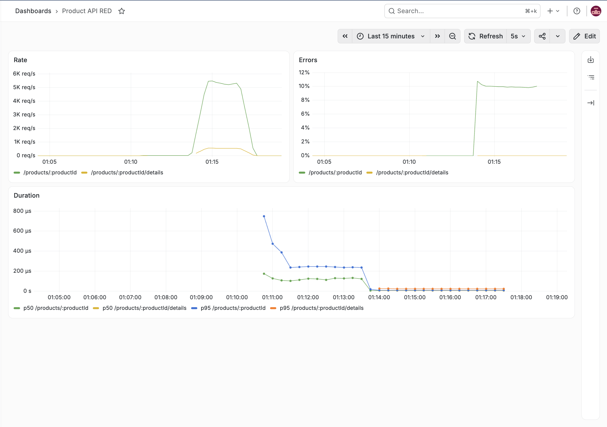

# Product API

A Product API written in Go (Gin) from the `api.yaml` spec, deployed to AWS ECS with Terraform, load tested with Locust, and monitored with Prometheus and Grafana.

## Where things are

| What                       | Where                                                                             |
| -------------------------- | --------------------------------------------------------------------------------- |
| Server code                | `src/product-service.go`                                                          |
| Dockerfile                 | `src/Dockerfile`                                                                  |
| Infrastructure (Terraform) | `terraform/` (`provider.tf`, `variables.tf`, `main.tf`, `outputs.tf`, `modules/`) |
| API spec                   | `api.yaml`                                                                        |
| Postman collection         | `postman/product-api.postman_collection.json`                                     |
| Load tests                 | `locustfile.py`, `stress_shape.py`, raw results in `results/`                     |
| Observability stack        | `docker-compose.yml`, `prometheus.yml`, `grafana-datasource.yml`                  |
| Screenshots                | `screenshots/`                                                                    |

## Part II: Product API

| Endpoint                             | Success | Errors        |
| ------------------------------------ | ------- | ------------- |
| `GET /products/{productId}`          | 200     | 404, 500      |
| `POST /products/{productId}/details` | 204     | 400, 404, 500 |

Notes:

- `api.yaml` has no create endpoint, so products 1-1000 are seeded in memory at startup.
- `GET` with an invalid ID returns 404, because the spec lists no 400 for GET.
- `POST` returns 400 if the `product_id` in the body does not match the path.
- A 500 can only be triggered locally, through `GET /debug/panic`, which exists only when `ENABLE_DEBUG=1`. It is not enabled on ECS.

Run locally (from the repo root):

```bash
cd src && ENABLE_DEBUG=1 go run product-service.go
```

or with Docker:

```bash
docker build -t product-api ./src
docker run --rm -e ENABLE_DEBUG=1 -p 8080:8080 product-api
```

### Examples of every response code

Import `postman/product-api.postman_collection.json` into Postman. It uses a `baseUrl` variable, set to `http://localhost:8080`.

| Code | Postman request                  | What it sends                                        |
| ---- | -------------------------------- | ---------------------------------------------------- |
| 200  | GET product 200                  | `GET /products/1`                                    |
| 204  | POST details 204                 | `POST /products/1/details` with a valid product body |
| 400  | POST details 400 missing fields  | body `{"sku":"x"}`                                   |
| 400  | POST details 400 malformed JSON  | body `{bad`                                          |
| 400  | POST details 400 id mismatch     | path ID 1, body `product_id` 2                       |
| 404  | GET Product 404                  | `GET /products/99999`                                |
| 404  | POST details 404 missing product | `POST /products/99999/details` with a valid body     |
| 500  | GET debug panic 500              | `GET /debug/panic` (local only)                      |

Postman run against the local server, 9/9 passing:



## Part III: Deploy to AWS ECS with Terraform

Prerequisites: AWS CLI, Terraform, and Docker running (Terraform builds and pushes the image). Credentials are from AWS Learner Lab. Region is `us-east-1`.

1. Set credentials:
   ```bash
   aws configure
   aws configure set aws_session_token <YOUR_SESSION_TOKEN>
   aws configure set region us-east-1
   ```
2. Deploy:
   ```bash
   cd terraform
   terraform init
   terraform apply
   ```
   On macOS, if Terraform reports it cannot connect to the Docker daemon, run this first:
   ```bash
   export DOCKER_HOST=$(docker context inspect --format '{{.Endpoints.docker.Host}}')
   ```
3. Get the task's public IP (run from `terraform/`):
   ```bash
   aws ec2 describe-network-interfaces \
   --network-interface-ids $(
       aws ecs describe-tasks \
       --cluster $(terraform output -raw ecs_cluster_name) \
       --tasks $(
           aws ecs list-tasks \
           --cluster $(terraform output -raw ecs_cluster_name) \
           --service-name $(terraform output -raw ecs_service_name) \
           --query 'taskArns[0]' --output text
       ) \
       --query "tasks[0].attachments[0].details[?name=='networkInterfaceId'].value" \
       --output text
   ) \
   --query 'NetworkInterfaces[0].Association.PublicIp' \
   --output text
   ```
   The first task can take a few minutes to start. The IP changes whenever the task restarts.
4. Send requests (plain `http`, port 8080):

   ```bash
   curl -i http://<PUBLIC-IP>:8080/products/1

   curl -i -X POST http://<PUBLIC-IP>:8080/products/1/details \
     -H "Content-Type: application/json" \
     -d '{"product_id":1,"sku":"NEW-1","manufacturer":"Acme","category_id":2,"weight":0,"some_other_id":3}'
   ```

   Or set the Postman `baseUrl` to `http://<PUBLIC-IP>:8080`.

5. Clean up:
   ```bash
   terraform destroy
   ```

The task runs one container of the `linux/amd64` image on Fargate with 0.25 vCPU and 512 MiB.

Postman run against ECS, 8/9 passing. The debug endpoint returns 404 because `ENABLE_DEBUG` is not set there, which is intentional.



## Part IV: Load testing

Locust runs on a laptop against the deployed API. The workload is 90% `GET /products/{id}` and 10% `POST /products/{id}/details` over the 1,000 seeded products, with no wait time between requests.

```bash
pip install locust
export API=http://<PUBLIC-IP>:8080
ulimit -n 10000
```

### HttpUser vs FastHttpUser

Same settings for both (200 users, spawn rate 20/s, 3 minutes), changing only the client:

```bash
LOCUST_CLIENT=http locust -f locustfile.py --headless --host $API -u 200 -r 20 -t 3m --html=results/httpuser.html
LOCUST_CLIENT=fast locust -f locustfile.py --headless --host $API -u 200 -r 20 -t 3m --html=results/fasthttp.html
```

|          | HttpUser | FastHttpUser |
| -------- | -------- | ------------ |
| Requests | 581,171  | 690,883      |
| Avg RPS  | 3,236    | 3,847        |
| Median   | 50 ms    | 44 ms        |
| p95      | 78 ms    | 81 ms        |
| p99      | 110 ms   | 130 ms       |
| Failures | 0        | 0            |




### Stress test

```bash
LOCUST_CLIENT=fast locust -f locustfile.py,stress_shape.py --host $API --csv=results/stress --html=results/stress.html
```

`stress_shape.py` ramps the load in four stages (about 10 minutes in total), using the same 9:1 request mix and `FastHttpUser`. Stage results are computed from `results/stress_stats_history.csv`:

| Stage (users) | Duration | RPS   | Mean latency | RPS per user |
| ------------- | -------- | ----- | ------------ | ------------ |
| 50            | 2 min    | 1,126 | 42.8 ms      | 22.5         |
| 200           | 2 min    | 4,120 | 47.6 ms      | 20.6         |
| 500           | 3 min    | 5,426 | 87.1 ms      | 10.9         |
| 1,000         | 3 min    | 6,907 | 129.7 ms     | 6.9          |

The whole run made 2,844,665 requests (about 4,740 RPS on average) with zero failures.




ECS CPU and memory utilization (UTC). 03:05 is the HttpUser run, 03:10 the FastHttpUser run, and 03:20-03:30 the stress test (11:05 PM, 11:10 PM and 11:20-11:30 PM on the Locust charts, local time).



## Part V: Observability

The server exposes `/metrics` (Prometheus) and writes one JSON log line per request to stdout. Prometheus and Grafana run locally and are not deployed to AWS.

```bash
docker compose up --build -d
```

- Prometheus: http://localhost:9090
- Grafana: http://localhost:3000 (login `admin` / `admin`), with a Prometheus data source already configured
- On an Intel or AMD machine, change `GOARCH: arm64` to `amd64` in `docker-compose.yml`.
- The app container is capped at 0.25 CPU, matching the Fargate task, and has `ENABLE_DEBUG=1`.

The dashboard `Product API RED` has three panels, built in Grafana with these queries:

| Panel              | Query                                                                                                                                                                    |
| ------------------ | ------------------------------------------------------------------------------------------------------------------------------------------------------------------------ |
| Rate (req/s)       | `sum by (endpoint) (rate(http_requests_total[1m]))`                                                                                                                      |
| Errors (% non-2xx) | `(100 * sum by (endpoint) (rate(http_errors_total[1m])) / sum by (endpoint) (rate(http_requests_total[1m]))) or (0 * sum by (endpoint) (rate(http_requests_total[1m])))` |
| Duration p50 / p95 | `histogram_quantile(0.50, sum by (le, endpoint) (rate(http_request_duration_seconds_bucket[1m])))` and the same with `0.95`                                              |

### Idle vs. loaded

- **Idle:** a `curl` loop at about 1 request per second for 3 minutes.
- **Loaded:** Locust for 3 minutes against the local stack. `BAD_WEIGHT=1` adds a deliberate 404 request (`/products/999999`) so the errors panel has data.

```bash
BAD_WEIGHT=1 LOCUST_CLIENT=fast locust -f locustfile.py --headless --host http://localhost:8080 -u 200 -r 20 -t 3m
```



The load starts at 01:13:38 and ends at 01:16:37, after the idle stretch. Rate rises from about 1 req/s to about 6K req/s (about 5.5K on GET and 0.6K on POST). Errors rise from 0% to about 10% on `/products/:productId` (the deliberate 404 requests) and stay at 0% on the details endpoint. Handler p50 and p95 stay in the microsecond range.

### Request log excerpt (from the same run)

```json
{"ts":"2026-10-19T05:16:37.822835422Z","method":"POST","endpoint":"/products/:productId/details","path":"/products/334/details","status":204,"duration_ms":0.016}
{"ts":"2026-10-19T05:16:37.823017672Z","method":"GET","endpoint":"/products/:productId","path":"/products/427","status":200,"duration_ms":0.001}
{"ts":"2026-10-19T05:16:37.823042088Z","method":"GET","endpoint":"/products/:productId","path":"/products/84","status":200,"duration_ms":0.001}
{"ts":"2026-10-19T05:16:37.823122005Z","method":"POST","endpoint":"/products/:productId/details","path":"/products/966/details","status":204,"duration_ms":0.005}
{"ts":"2026-10-19T05:16:37.823138047Z","method":"GET","endpoint":"/products/:productId","path":"/products/999999","status":404,"duration_ms":0.003}
```

### Dashboard or logs?

I would look at the dashboard to see that something changed and how (rate climbing, p95 latency rising, an error percentage appearing) in real time, across all requests at once. I would look at the logs to find which specific requests were slow or failed (the exact path, status and duration) after the fact, when nobody was watching the dashboard.
